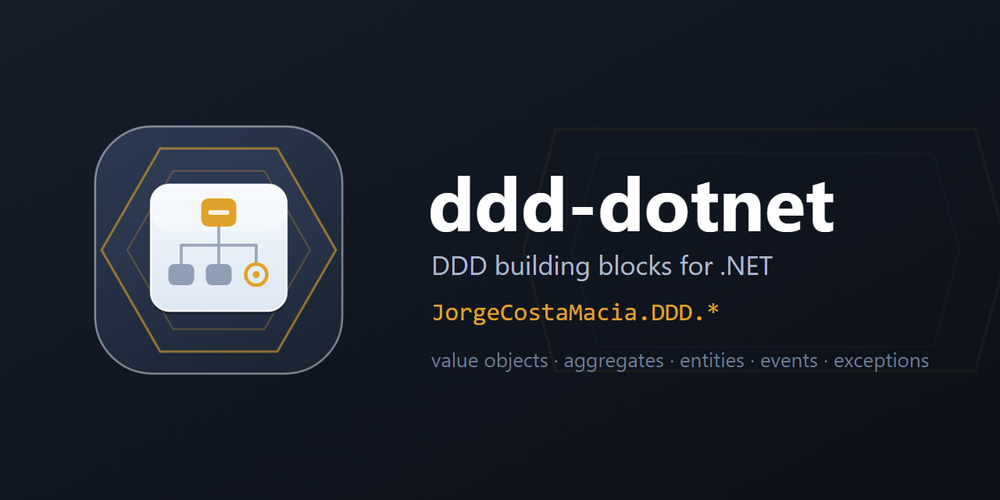

  

# ddd-dotnet

> DDD building blocks for .NET — value objects with their FluentValidation validators, aggregates, entities, domain events and a domain exception hierarchy — each scoped to a single concern and shipped independently under `JorgeCostaMacia.DDD.*`.

Part of the `JorgeCostaMacia.*` family, alongside [quartz-dotnet](https://github.com/JorgeCostaMacia/quartz-dotnet) (Quartz.NET extensions), [serilog-dotnet](https://github.com/JorgeCostaMacia/serilog-dotnet) (the Serilog baseline), [bus-dotnet](https://github.com/JorgeCostaMacia/bus-dotnet) (messaging) and [http-dotnet](https://github.com/JorgeCostaMacia/http-dotnet) (ASP.NET Core). Moved out of [shared-net](https://github.com/JorgeCostaMacia/shared-net) in 11.0.0, which renamed the packages and their namespaces from `JorgeCostaMacia.<X>` to `JorgeCostaMacia.DDD.<X>`; the old ids stay on nuget.org, deprecated in favour of these.

## Requirements

The **.NET 10** SDK.

## Packages

| Package | What it does |
| --- | --- |
| [JorgeCostaMacia.DDD.ValueObject](https://www.nuget.org/packages/JorgeCostaMacia.DDD.ValueObject/) | Immutable typed value objects (primitives, semantic types, paging, ordering) with their FluentValidation validators and the four-factory surface (`From`, `FromOrNull`, `Create`, `CreateOrNull`). |
| [JorgeCostaMacia.DDD.Aggregate](https://www.nuget.org/packages/JorgeCostaMacia.DDD.Aggregate/) | The aggregate root base, which collects `IDomainEvent`s for a pull-and-publish unit of work. |
| [JorgeCostaMacia.DDD.Entity](https://www.nuget.org/packages/JorgeCostaMacia.DDD.Entity/) | `IEntity` marker — identity-based entities. |
| [JorgeCostaMacia.DDD.DomainEvent](https://www.nuget.org/packages/JorgeCostaMacia.DDD.DomainEvent/) | `IDomainEvent` marker — transport-agnostic domain events. |
| [JorgeCostaMacia.DDD.Exception](https://www.nuget.org/packages/JorgeCostaMacia.DDD.Exception/) | The domain exception hierarchy (`Validation`, `NotFound`, `Exist`, `Error`) with traceable metadata. |

## Upgrading

What each version asks of you, when it asks anything, is in [CHANGELOG.md](CHANGELOG.md).

## Contact

- [LinkedIn](https://www.linkedin.com/in/jorge-costa-macia-842817164/)
- [GitHub](https://github.com/JorgeCostaMacia/)
- [Bitbucket](https://bitbucket.org/jorgecostamacia/)
